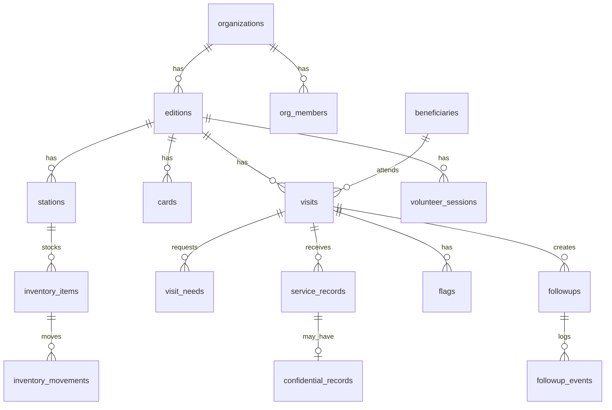

# Gratitude Connect — Data Model

Postgres (Supabase). Every table has `id uuid primary key` (UUID v7 generated client-side where the client creates rows), `created_at timestamptz default now()` and `updated_at timestamptz default now()`, plus `deleted_at timestamptz null` (soft delete) unless noted. **RLS is enabled on every table.**

Required extensions: `pgcrypto`, `pg_trgm`, `citext`.

---

## 1. Entity overview



---

## 2. Tables (DDL sketch)

```sql
-- ORGANISATION & ADMINS --------------------------------------------------
create table organizations (
  id uuid primary key default gen_random_uuid(),
  name text not null,                       -- "Gratitude Outreach"
  church_name text,
  consent_text text not null,               -- read-aloud script (versioned below)
  consent_version int not null default 1,
  retention_months int not null default 24,
  created_at timestamptz default now(), updated_at timestamptz default now()
);

create type org_role as enum ('super_admin','coordinator','followup','viewer');
create table org_members (
  org_id uuid references organizations on delete cascade,
  user_id uuid references auth.users on delete cascade,
  role org_role not null,
  display_name text,
  primary key (org_id, user_id)
);

-- EDITIONS & STATIONS ------------------------------------------------------
create type edition_status as enum ('draft','live','closed');
create table editions (
  id uuid primary key default gen_random_uuid(),
  org_id uuid not null references organizations,
  name text not null,                       -- "Gratitude Outreach 2026"
  code_prefix text not null,                -- "GO26"
  starts_on date not null, ends_on date not null,
  venue text,
  status edition_status not null default 'draft',
  is_training boolean not null default false,
  closed_at timestamptz,
  created_at timestamptz default now(), updated_at timestamptz default now()
);

create type station_kind as enum ('registration','prayer','counselling','medical','food','clothing','checkout','custom');
create table stations (
  id uuid primary key default gen_random_uuid(),
  edition_id uuid not null references editions on delete cascade,
  kind station_kind not null,
  name text not null,
  icon text, color text,
  sort_order int default 0,
  enabled boolean default true,
  is_service boolean default true,          -- false for registration/checkout (not a "need")
  join_pin_hash text not null,              -- crypt(pin, gen_salt('bf'))
  role_pin_hash text,                       -- required for medical/counselling
  form_schema jsonb,                        -- custom station fields (P1)
  created_at timestamptz default now(), updated_at timestamptz default now()
);

-- One per volunteer per edition. Registered with the station PIN + name + phone;
-- signed in with name + phone on any number of devices (migration 011).
create table volunteer_accounts (
  id uuid primary key default gen_random_uuid(),
  edition_id uuid not null references editions,
  station_id uuid not null references stations,
  display_name text not null,
  phone text not null,                      -- E.164; doubles as the sign-in password
  designation text,
  disabled_at timestamptz,
  unique (edition_id, phone)
);

create type session_role as enum ('volunteer','station_lead');
create table volunteer_sessions (          -- one per device
  account_id uuid references volunteer_accounts,
  id uuid primary key default gen_random_uuid(),
  user_id uuid not null references auth.users,  -- anonymous auth user
  edition_id uuid not null references editions,
  station_id uuid not null references stations,
  role session_role not null default 'volunteer',
  display_name text not null,
  phone text,
  designation text,                         -- Dr / Nurse / Pharm / Counsellor
  device_label text,
  confidential_ack_at timestamptz,
  expires_at timestamptz not null,
  revoked_at timestamptz,
  last_seen_at timestamptz,
  created_at timestamptz default now()
);
create index on volunteer_sessions (user_id) where revoked_at is null;

create table join_attempts (                -- rate limiting
  id bigserial primary key, user_id uuid, ip text, success boolean, at timestamptz default now()
);

-- CARDS --------------------------------------------------------------------
create type card_status as enum ('unassigned','assigned','void');
create table cards (
  id uuid primary key default gen_random_uuid(),
  edition_id uuid not null references editions on delete cascade,
  code text not null,                       -- "GO26-0142"
  batch_no int not null,
  status card_status not null default 'unassigned',
  visit_id uuid,                            -- set when assigned
  voided_reason text,
  updated_at timestamptz default now(),
  unique (edition_id, code)
);

create table code_blocks (                  -- on-the-spot codes reserved per device (P1)
  id uuid primary key default gen_random_uuid(),
  edition_id uuid references editions, session_id uuid references volunteer_sessions,
  prefix text not null, range_start int not null, range_end int not null, next_value int not null
);

-- PEOPLE -------------------------------------------------------------------
create type age_range as enum ('0-12','13-17','18-35','36-59','60+');
create type gender as enum ('female','male','undisclosed');
create table beneficiaries (
  id uuid primary key,                      -- client uuidv7
  org_id uuid not null references organizations,
  full_name text not null,
  full_name_search text generated always as (lower(full_name)) stored,
  phone text,                               -- E.164 +234...
  phone_last4 text generated always as (right(phone, 4)) stored,
  gender gender,
  age_range age_range,
  community text,
  language text,
  church_member text check (church_member in ('yes','no','visitor')),
  guardian_beneficiary_id uuid references beneficiaries,
  guardian_name text,
  merged_into uuid references beneficiaries,
  created_at timestamptz default now(), updated_at timestamptz default now(), deleted_at timestamptz
);
create index on beneficiaries using gin (full_name_search gin_trgm_ops);
create index on beneficiaries (phone);
create index on beneficiaries (phone_last4);

create type visit_status as enum ('active','checked_out');
create table visits (
  id uuid primary key,                      -- client uuidv7
  edition_id uuid not null references editions,
  beneficiary_id uuid not null references beneficiaries,
  card_code text,                           -- denormalised for fast lookup
  household_size int,
  status visit_status not null default 'active',
  registered_by_session uuid references volunteer_sessions,
  registered_at timestamptz not null,
  checked_out_at timestamptz,
  consent_data_at timestamptz not null,
  consent_followup_at timestamptz,
  consent_version int not null,
  client_updated_at timestamptz,
  created_at timestamptz default now(), updated_at timestamptz default now(), deleted_at timestamptz,
  unique (edition_id, beneficiary_id),
  unique (edition_id, card_code)
);

create type need_state as enum ('pending','served','declined','referred');
create table visit_needs (
  visit_id uuid references visits on delete cascade,
  station_id uuid references stations,
  state need_state not null default 'pending',
  source text not null default 'registration',  -- registration | referral:<station_id>
  state_at timestamptz default now(),
  declined_reason text,
  updated_at timestamptz default now(),
  primary key (visit_id, station_id)
);

-- SERVICES -----------------------------------------------------------------
create table service_records (               -- APPEND-ONLY
  id uuid primary key,                      -- client uuidv7
  edition_id uuid not null references editions,
  visit_id uuid not null references visits,
  station_id uuid not null references stations,
  session_id uuid not null references volunteer_sessions,
  served_by_name text not null,             -- snapshot of volunteer display name
  summary text not null,                    -- safe one-liner for timeline, e.g. "Family pack ×1"
  data jsonb not null default '{}',         -- NON-confidential structured fields (see §3)
  has_confidential boolean not null default false,
  served_at timestamptz not null,           -- device time
  created_at timestamptz default now(),
  voided_at timestamptz, voided_by uuid, void_reason text
);
create index on service_records (visit_id, served_at);
create index on service_records (edition_id, station_id, served_at);

create type confidential_kind as enum ('medical','counselling');
create table confidential_records (          -- STRICT RLS
  service_record_id uuid primary key references service_records on delete cascade,
  edition_id uuid not null references editions,
  visit_id uuid not null references visits,
  kind confidential_kind not null,
  payload jsonb not null,                   -- see §3
  redacted_at timestamptz,
  created_at timestamptz default now()
);

create type flag_scope as enum ('all','medical','counselling','leads');
create table flags (
  id uuid primary key,
  visit_id uuid not null references visits,
  kind text not null,                       -- referral | allergy | urgent_counselling | abnormal_vitals | already_fed
  scope flag_scope not null default 'all',
  text text not null,
  created_by_session uuid,
  resolved_at timestamptz,
  created_at timestamptz default now(), updated_at timestamptz default now()
);

-- INVENTORY ----------------------------------------------------------------
create table inventory_items (
  id uuid primary key default gen_random_uuid(),
  edition_id uuid not null references editions,
  station_id uuid not null references stations,
  name text not null,                       -- "Family food pack", "Paracetamol 500mg (strip)", "Children shirt"
  unit text default 'pcs',
  sizes text[],                             -- clothing sizes
  opening_qty int not null default 0,
  remaining int not null default 0,         -- maintained by trigger
  low_threshold int default 20,
  updated_at timestamptz default now()
);
create table inventory_movements (           -- APPEND-ONLY
  id uuid primary key,
  item_id uuid not null references inventory_items,
  delta int not null,                       -- negative for dispense
  reason text not null,                     -- service | restock | damage | correction
  service_record_id uuid references service_records,
  session_or_user uuid,
  created_at timestamptz default now()
);

-- FOLLOW-UP ----------------------------------------------------------------
create type followup_type as enum ('salvation','rededication','prayer','counselling','counselling_urgent','medical_referral','fellowship');
create type followup_status as enum ('new','assigned','contacted','completed','unreachable');
create table followups (
  id uuid primary key default gen_random_uuid(),
  edition_id uuid not null references editions,
  visit_id uuid not null references visits,
  type followup_type not null,
  status followup_status not null default 'new',
  assignee_user_id uuid references auth.users,
  source_service_record_id uuid references service_records,
  preferred_time text,
  due_on date,
  created_at timestamptz default now(), updated_at timestamptz default now()
);
create table followup_events (
  id uuid primary key default gen_random_uuid(),
  followup_id uuid not null references followups on delete cascade,
  outcome text not null,                    -- reached | no_answer | wrong_number | visited | note
  note text,
  by_user uuid references auth.users,
  created_at timestamptz default now()
);

-- AUDIT --------------------------------------------------------------------
create table audit_log (
  id bigserial primary key,
  at timestamptz default now(),
  actor_user uuid, actor_session uuid,
  action text not null,                     -- insert | update | delete | export | confidential_view | break_glass | merge
  table_name text, row_id uuid,
  before jsonb, after jsonb,
  meta jsonb                                -- device, reason, export dataset
);
```

---

## 3. `data` / `payload` JSON shapes (validated by Zod on both ends)

```ts
// service_records.data (NON-confidential)
type PrayerData   = { focus: string[]; decision: 'none'|'salvation'|'rededication'; wants_followup: boolean; join_fellowship: boolean; notes?: string };
type FoodData     = { items: { item_id: string; qty: number }[]; household_served?: number; override_by?: string };
type ClothingData = { items: { item_id: string; size?: string; qty: number }[]; for: 'self'|'child'|'other' };
type CounsellingData = { category: string; followup_needed: boolean; risk: 'none'|'pastoral'|'urgent'; refer_medical: boolean }; // category & risk counts are OK for aggregates
type MedicalData  = { tests: string[]; referred: boolean; referral_urgency?: 'routine'|'urgent'; items: { item_id: string; qty: number }[] };
type CustomData   = Record<string, unknown>;
// Common optional: refer_to_station_ids?: string[]

// confidential_records.payload
type CounsellingPayload = { notes: string; preferred_time?: string };
type MedicalPayload = {
  vitals: { bp_sys?: number; bp_dia?: number; pulse?: number; temp_c?: number; weight_kg?: number; rbs_mg_dl?: number; height_cm?: number };
  complaint: string[]; complaint_text?: string; impression?: string;
  dispensed: { item_id: string; qty: number; dosage?: string }[];
  referral?: { facility: string; reason: string; urgency: 'routine'|'urgent' };
  allergies?: string; designation: 'Dr'|'Nurse'|'Pharm'|'Other';
};
```

**Timeline summary rules** (computed on the client, stored in `summary`):
- Prayer: `"Health, Family · Salvation"`; notes are not included.
- Counselling: always `"Counselling session"` (category is NOT shown in summary).
- Medical: `"Medical check · referred"` / `"Medical check"`; no vitals or diagnosis.
- Food: `"Family pack ×1"`. Clothing: `"3 items (2 child)"`.

---

## 4. RLS policy matrix

| Table | Volunteer session (own edition) | Medical session | Counselling session | Coordinator / Super Admin | Follow-up | Viewer |
|---|---|---|---|---|---|---|
| editions, stations | read (no PIN hashes; expose via view `stations_public`) | same | same | full | read | read |
| beneficiaries | read/insert (registration) · update basic fields | read | read | full | read (consented contacts) | aggregates only |
| visits, visit_needs | read · insert (registration) · update needs | read/update | read/update | full | read | aggregates |
| service_records | read all in edition · insert for **own station only** | same | same | read · void | read | aggregates |
| confidential_records | ❌ | **read/insert kind=medical** | **read/insert kind=counselling** | ❌ (break-glass only) | ❌ | ❌ |
| flags | read where scope='all' or matches station kind | + medical | + counselling | read all | read | ❌ |
| inventory_items | read · (movements via trigger) | read | read | full | ❌ | read |
| followups (+events) | ❌ | ❌ | ❌ | full | read/update assigned or all | aggregates |
| audit_log | ❌ | ❌ | ❌ | read (super_admin) | ❌ | ❌ |

Station leads get the same as their station, plus override PIN validation and inventory adjustments for their station.

Write **pgTAP tests** for every cell marked ❌ (must be denied) and for "own station only" inserts.

---

## 5. Views for the dashboard (non-confidential)

- `v_edition_kpis(edition_id, registered, served_unique, services, on_site, decisions, referrals)`
- `v_station_stats(edition_id, station_id, served, pending, avg_service_seconds, active_volunteers)`
- `v_hourly_flow(edition_id, hour, arrivals, services_by_station jsonb)`
- `v_demographics(edition_id, gender, age_range, community, count)`
- `v_sync_health(edition_id, session_id, device_label, last_seen_at)`; devices also report `pending_ops` via a heartbeat RPC every 30 s.

---

## 6. Seed / training data

`supabase/seed.sql` creates an organisation, an edition "Training 2026" (`is_training = true`) with all default stations (PINs `111111`… documented in README), 60 inventory items and 300 fake Nigerian names across communities (Kpegi, Jikwoyi, Karu, Nyanya, Kugbo, Orozo…), with random needs and services so the dashboard looks alive during training.
