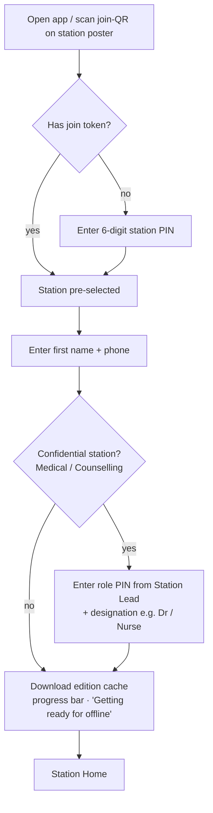
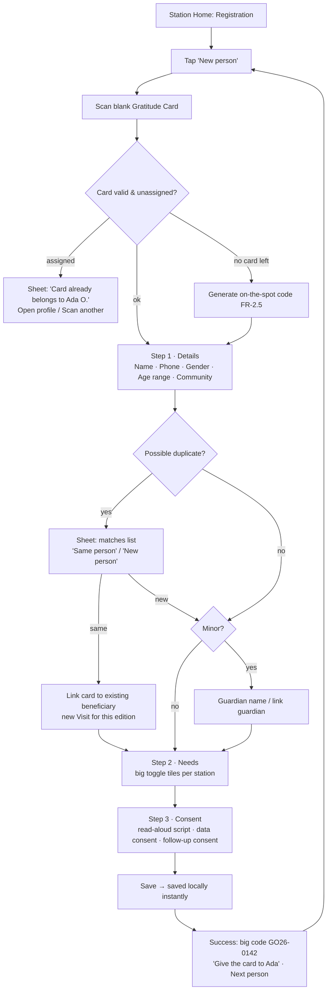
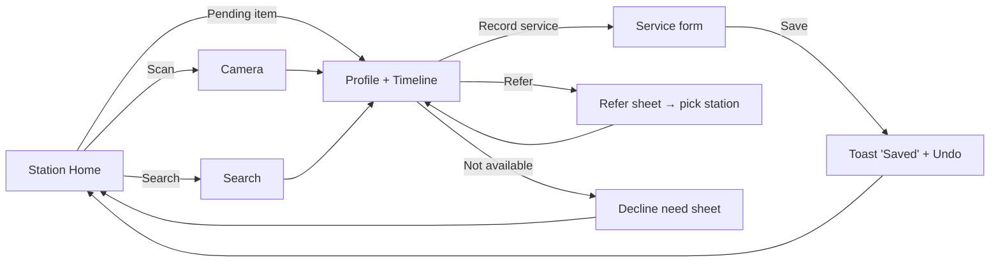
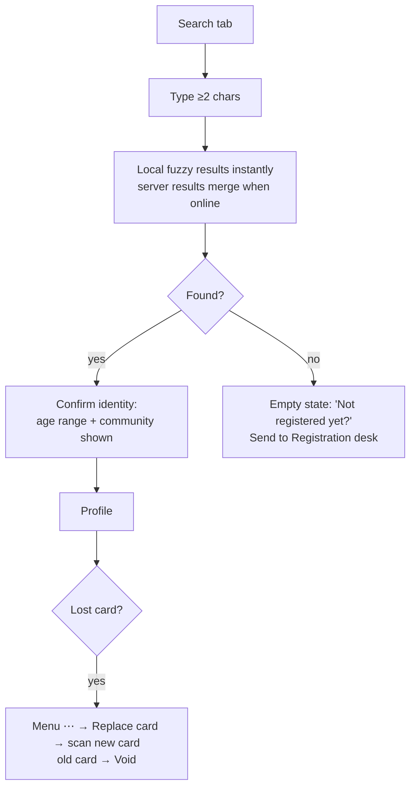
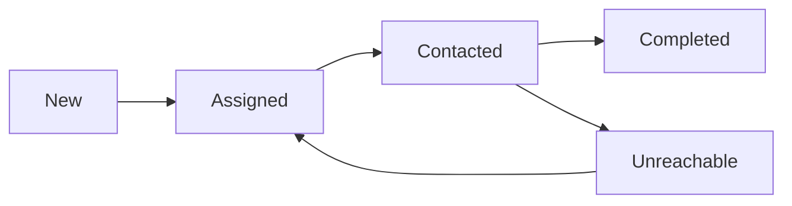

# Gratitude Connect — Design Flow

This document defines **who goes where, screen by screen**. Read it with `DesignSystem.md` (visual rules) and `PRD.md` (requirement IDs in brackets).

Two surfaces:
- **Volunteer app**: mobile-first PWA, portrait, one-hand use, works offline. Routes under `/s/*` (station).
- **Admin console**: desktop/tablet responsive web. Routes under `/admin/*`.

---

## 1. Site map

```
/                         → Landing: "Join a station" or "Admin sign in"
/join                     → Volunteer join (PIN or scan join-QR)
/join/[token]             → Deep link from join-QR / WhatsApp

/s                        → Station home (Scan · Search · Pending · Recent)
/s/scan                   → Camera scanner (full screen)
/s/search                 → Search (code / name / phone)
/s/register               → Registration flow (Registration station only)
/s/p/[visitId]            → Beneficiary profile + timeline + "Record service"
/s/p/[visitId]/serve      → Station service form
/s/pending                → Pending list for this station
/s/settings               → My session, switch station (if allowed), sync status, training mode

/admin/login
/admin                    → Live dashboard (current edition)
/admin/editions           → List / create / clone editions
/admin/editions/[id]/setup      → Stations, forms, PINs
/admin/editions/[id]/cards      → Card batches + print PDF
/admin/editions/[id]/inventory  → Stock per station
/admin/editions/[id]/volunteers → Sessions, devices, move/revoke
/admin/beneficiaries            → Directory across editions, merge duplicates
/admin/beneficiaries/[id]       → Full record (role-filtered)
/admin/follow-ups               → Follow-up pipeline (board + list)
/admin/reports                  → Edition summary, YoY, exports
/admin/audit                    → Audit log
/admin/settings                 → Org, admins & roles, retention, consent text
```

---

## 2. Primary flows

### Flow A: Volunteer joins a station (FR-12.1, FR-12.2)



**Screens**
1. **Join**: logo (white on forest hero), 6 large PIN boxes, "Scan station QR instead" link. Error: "That PIN doesn't match a station. Ask your station lead." Locks for 5 minutes after 5 tries.
2. **Who are you?**: First name, Phone. Button "Start serving".
3. **Role PIN** (confidential only): explains "You'll see private notes. Keep them private." with a checkbox "I agree to keep information confidential".
4. **Preparing offline**: progress bar with a count ("Saving 1,204 people for offline use"). Skippable once more than 0 is cached.

---

### Flow B: Registration (FR-3.x)



**Registration screen layout (mobile)**

```
┌──────────────────────────────┐
│ ▓▓ [mark] Registration  ●Sync│  ← forest header
├──────────────────────────────┤
│ Card  [ GO26-0142 ✓ ]        │  ← code chip after scan
│ Step 1 of 3 ━━━━──────       │
│                              │
│ Full name *                  │
│ [______________________]     │
│ Phone (optional)             │
│ [+234 ▾][______________]     │
│ Gender   (Female)(Male)      │  ← segmented
│ Age range                    │
│ (0–12)(13–17)(18–35)         │
│ (36–59)(60+)                 │  ← chips, wrap
│ Community                    │
│ [Kpegi ▾ search…_______]     │
│ ▸ More (household, language, │
│   church member)             │  ← collapsed optional fields
│                              │
│ [        Next  →         ]   │  ← 56px leaf button, sticky
└──────────────────────────────┘
```

Step 2 (Needs) uses **2-column large tiles** with station icon and colour; tap toggles a check.
Step 3 (Consent) shows the script in a `neutral-50` card in `body-lg`, then two checkboxes (data processing, which is required; follow-up contact, which is optional).

---

### Flow C: Station loop (the core flow, used thousands of times) (FR-4, 5, 6)



**Target: Scan → Saved in ≤ 4 taps for Food and Clothing**, and ≤ 8 for Prayer.

**Station Home**

```
┌──────────────────────────────┐
│ ▓▓ [mark] Food      ●Synced  │
├──────────────────────────────┤
│  Pending 42 · Served 118     │  ← counter chips
│                              │
│         ╭──────────╮         │
│         │  ▣ SCAN  │         │  ← 160px leaf circle
│         │   CARD   │         │
│         ╰──────────╯         │
│                              │
│ [🔍 Search name, phone, code]│
│ [⌨ Type card code]           │
│                              │
│ Pending (42)          See all│
│ ○ Ada Okafor   GO26-0142 10:02│
│ ○ Musa Bello   GO26-0151 10:05│
│ Recent                       │
│ ✓ John E.      GO26-0098 10:11│
└──────────────────────────────┘
│ Home │ Pending │ Search │ Me │   ← bottom nav
```

**Profile + Timeline**

```
┌──────────────────────────────┐
│ ← Back              ●Synced  │
├──────────────────────────────┤
│ Ada Okafor        ↺Returning │
│ GO26-0142 · F · 36–59 · Kpegi│
│ Language: Pidgin             │
├──────────────────────────────┤
│ ⚠ Referred here by Counsel-  │  ← AlertBanner (if any)
│   ling at 10:20              │
├──────────────────────────────┤
│ Needs                        │
│ [✓Prayer 10:12][○Medical]    │
│ [○Food][✕Clothing–out]       │
├──────────────────────────────┤
│ Today                        │
│ ● 10:20 Counselling 🔒        │
│   Confidential session · Bro.│
│ ● 10:12 Prayer               │
│   Health, Family · Salvation │
│   by Sis. Ngozi              │
│ ● 09:58 Registered by Tobi   │
├──────────────────────────────┤
│ [   Record Food service   ]  │  ← sticky primary
│ [Refer]  [Not available]     │  ← secondary row
└──────────────────────────────┘
```

New timeline items arriving via realtime slide in at the top with a `fresh-50` highlight that fades over 2 s.

**Already-served guard:** if this station already served the person this edition, the primary button changes to "Already served at 10:31 · Record again?" and opens a confirmation sheet. Food needs a Station Lead PIN override (FR-6.4).

---

### Flow D: Station-specific forms

| Station | Form pattern | Notes |
|---|---|---|
| **Food** | One screen: pack-type tiles with stock counts → quantity stepper (default 1) → household size (prefilled) → Save | Ideal: 2 taps |
| **Clothing** | Item list: category tile → size chips → qty stepper → "Add another" → For: Self/Child/Other → Save | Basket summary at the bottom |
| **Prayer** | Focus chips (multi) → Decision segmented [None · Salvation · Rededication] → toggles "Wants follow-up", "Join fellowship" → Notes → Save | A decision shows a gentle celebratory check and "Follow-up created" |
| **Counselling 🔒** | Category chips → Notes (large textarea, autosave draft locally) → Risk flag segmented (None · Pastoral · **Urgent**) → Follow-up toggle and preferred time → Refer to Medical toggle → Save | Urgent shows a `danger` banner: "Station Lead notified" |
| **Medical 🔒** | Accordion steps: **Vitals** (BP sys/dia, pulse, temp, weight, RBS; live range hints) → **Complaint** (quick chips: Fever, Headache, Body pain, Cough, Eye, Hypertension follow-up, Diabetes follow-up, Skin, Other) → **Tests** (chips) → **Impression** → **Dispense** (StockPicker plus qty plus dosage text) → **Referral** (toggle → facility, reason, urgency) → Save | Abnormal vitals pin a summary at the top. Allergy field stored as a medical-only flag |
| **Custom** | Renders fields from config in order | P1 |

---

### Flow E: Search and lost card (FR-4.2, FR-2.4)



---

### Flow F: Coordinator live dashboard (FR-9)

```
┌────────┬──────────────────────────────────────────────────────┐
│ [logo] │ Gratitude Outreach 2026 · LIVE ●     Sync: 3 devices ⚠│
│        ├──────────────────────────────────────────────────────┤
│ Live   │ Registered  Served   Services  On site  Decisions Ref.│
│ Edition│   1,204     1,087     3,912     341       57       23 │  ← KPI tiles
│ People ├──────────────────────────────────────────────────────┤
│ Follow │ [Prayer] [Counsel] [Medical] [Food] [Clothing]        │
│ Reports│  served/pending/avg/stock bar/volunteers per card     │
│ Audit  ├───────────────────────────┬──────────────────────────┤
│ Setting│ Arrivals per hour (line)  │ Alerts                   │
│        │                           │ ⚠ Food packs low (38)    │
│        │                           │ ⚠ Device 'Tobi-A12' 14   │
│        │                           │   unsynced for 22 min    │
│        │                           │ 🔴 Urgent counselling ×1  │
│        ├───────────────────────────┴──────────────────────────┤
│        │ Demographics · Top communities · Volunteer activity  │
└────────┴──────────────────────────────────────────────────────┘
```

The sidebar uses `forest` with the white wordmark; the content area uses the `neutral-25` background. Click a station card to drill into that station's served/pending lists and stock.

---

### Flow G: Event preparation (admin, before the day)

```mermaid
flowchart LR
  A[Create / clone edition] --> B[Configure stations<br/>enable · rename · icons]
  B --> C[Set role PINs for Medical & Counselling]
  C --> D[Add inventory: food packs, clothes, meds]
  D --> E[Generate card batch e.g. 1,500]
  E --> F[Download print PDF → print → cut]
  F --> G[Print station posters with join-QR]
  G --> H[Training mode run-through with volunteers]
  H --> I[Set edition LIVE on the day]
```



**Station poster (printable A4):** station name and icon, join QR, PIN, and three-step instructions ("1. Scan this QR. 2. Enter your name. 3. Tap Scan card for each person").

**Gratitude Card (print, 85 × 55 mm):**

```
┌───────────────────────────────────┐
│ [gratitude logo]       ┌───────┐  │
│                        │ ▓QR▓  │  │
│ Gratitude Outreach 2026│ ▓▓▓▓  │  │
│                        └───────┘  │
│ GO26-0142                         │  ← code token, large
│ Keep this card with you today.    │
└───────────────────────────────────┘
```
Card back (optional): "Thank you for coming. God loves you." plus church name and service times.

---

### Flow H: Follow-up after the event (FR-10)



- **Board view** (desktop): kanban columns as above; cards show name, type badge (Salvation, Prayer, Counselling, Medical referral), community, assignee.
- **List view** (mobile): filter chips; each row has 📞 Call and WhatsApp buttons; tapping opens an outcome sheet (Reached / No answer / Wrong number, notes, next step).

---

### Flow I: Close edition and reports (FR-1.6, FR-11)

1. Coordinator taps **Close edition**. A pre-check sheet appears: "4 devices have unsynced records. Wait or close anyway?"
2. On close: the edition becomes read-only and the summary report is generated.
3. Reports page: summary preview (branded PDF), export buttons (XLSX/CSV per dataset), YoY tab.

---

## 3. States checklist (every screen must handle)

| State | Pattern |
|---|---|
| Loading | Skeletons in `neutral-50`; never a blank screen |
| Empty | Logo-motif illustration plus a helpful line plus action ("No one pending. Nice work 🙌") |
| Offline | Header pill shows offline; actions still work; banner on first offline: "You're offline. Keep serving — we'll sync later." |
| Error (save) | Saved locally anyway; sync pill shows error; tap opens retry details |
| Permission (camera denied) | Explain plus fallback to "Type card code" |
| Confidential locked | 🔒 badge plus "Only counsellors can see this" |
| Edition closed | Read-only banner; forms disabled |
| Training mode | Persistent `warning` ribbon "TRAINING — data won't be saved to the real event" |

---

## 4. Copy guidelines

- Warm, dignified, simple. Say "person" or the name, never "case" or "client".
- Volunteer-facing verbs: *Scan card, Record service, Refer, Not available, Save*.
- Never show beneficiary personal data on public screens; first name plus card code only.
- Confirmation toasts include the person's first name ("Saved · Food for Ada").
